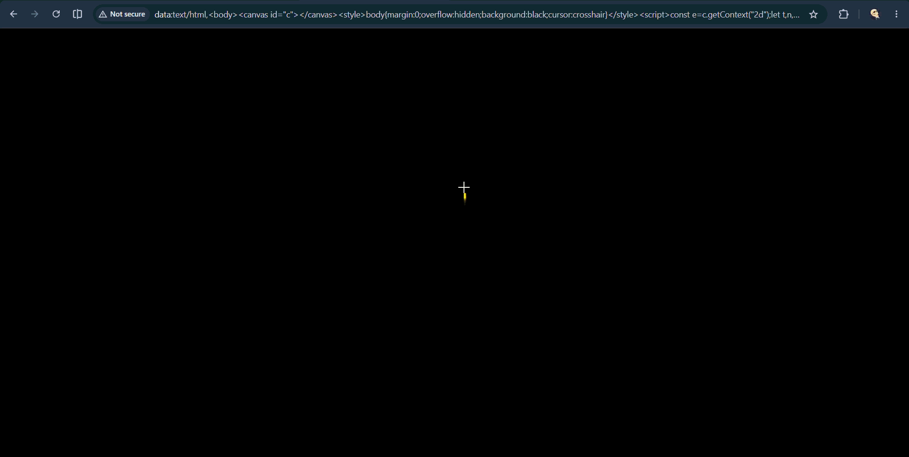

# Fireworks

Fireworks is a simple firework show that is made for the SHRINK Hackathon by Hack Club. Its made using HTML and Vanilla JavaScript. Canvas 2D API draws everything, rockets sparks and trails. The Web Audio API makes the whistle and boom sounds. I have hand written the 3D math for the cool rotation visuals, and yup it all fits under 3KB (2467 / 3072 bytes, 605 left) URI.
Here is a gif of it:

## how to use it
Its pretty simple to use it.
1. First you copy the URI [{URI}](dist/uri.txt) and paste it in your browser.
2. Now you will see a black screen with small green text, that are the instructions i am gonna give you here.
3. You can do 3 things with it.\
   A. Click on the screen to launch 1 firework.\
   B. Drag the screen and rotate the firework particles.\
   C. Press space for a grand finale for launching 8 fireworks, one every 120ms.

## how it works

**Rockets:** A click calls launch(). The rocket starts at the bottom and each frame moves 7% of the remaining distance toward the click point (* 0.07). \
**Burst:** 120 sparks are created by each explosion. Each spark gets a random direction on a sphere (x, y and z velocity), a speed between 3.5 and 5, and a hue near the burst’s base color. \
**Physics:** Every frame, each spark gets gravity on y, 2% drag (* 0.98), and its life drops by 0.012. When life reaches 0 it’s removed. \
**3D:** Spark positions are stored in 3D. For drawing, they’re rotated around the Y axis (yaw) and then around X (pitch), then perspective scales them with 400 / (400 + z). \
**Trails and Glow:** The canvas isnt cleared each frame. A black fill at 0.2 alpha lets old frames fade out, and the "lighter" blend mode makes overlapping sparks add up to brighter light. \
**Sound:** The whistle is a sawtooth oscillator sweeping from 300 Hz to 1200 Hz, and the boom is a sine dropping from 140 Hz to 30 Hz. The crackle is a half-second buffer where about 3% of the samples are random, fading out. The sound starts after the first click or space press, the browser blocks it before that. \
**Finale:** The finale launches 8 rockets at a 120ms gap and it also ignores key repeat and has a 2 seconds cool down.

### badges

## problems I ran into

## building